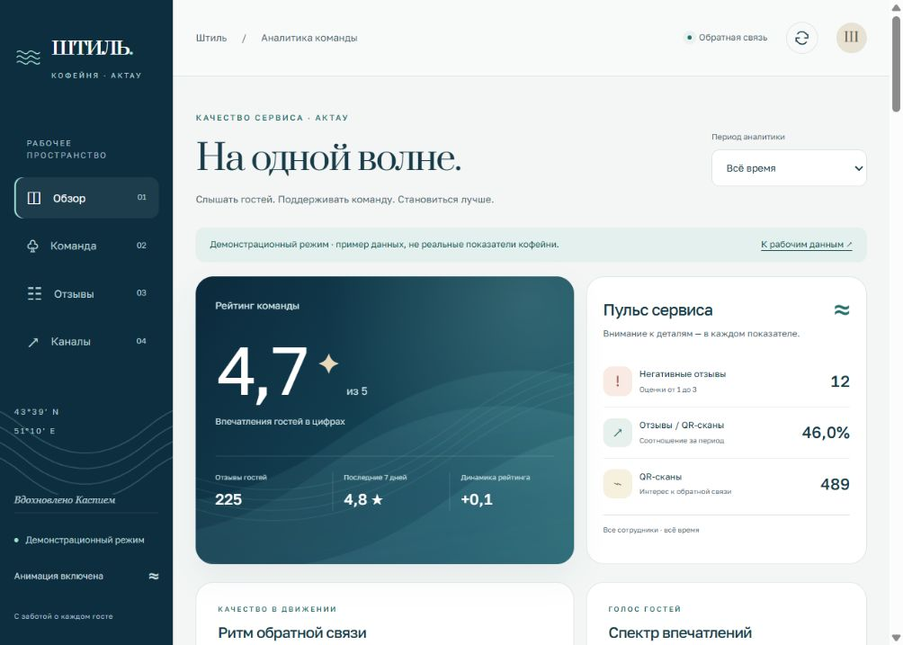

# Штиль · AdminFeedback

**На одной волне.** Аналитика обратной связи гостей и команды кофейни «Штиль» в Актау. Версия 2.0: новый морской стиль, анимированные волны Каспия и проверяемые расчёты на данных Google Sheets.

[Открыть дашборд](https://yernaribadulla.github.io/AdminFeedback/) · [Посмотреть дизайн на демо](https://yernaribadulla.github.io/AdminFeedback/?demo=1) · [Отчёт проверки](docs/audit.md)



## Возможности

- Средний рейтинг, количество отзывов, негативные оценки и QR-сканы.
- Общий период и выбранный сотрудник для рейтинга, графика, отзывов и переходов.
- Динамика среднего рейтинга за 14 дней, распределение оценок и сравнение двух недель.
- Рейтинг команды с количеством отзывов; выбор карточки сотрудника фильтрует все показатели.
- Поиск по тексту/имени, режим отзывов с оценкой ≤ 3, лента по 30 записей.
- Переходы на 2ГИС, Яндекс и Instagram.
- Явные состояния загрузки, пустой таблицы, частичного сбоя и устаревших данных.
- Многослойные SVG-волны, мягкий свет, контурная анимация, появление блоков, счётчики, прорисовка графика и hover-переходы.
- Пауза всех анимаций с сохранением предпочтения. Системный `prefers-reduced-motion` имеет приоритет.
- Адаптивная вёрстка, мобильная навигация, клавиатурный focus, текстовые подписи и доступный SVG-график.

## Запуск

На сервере нужны только статические файлы. Нет сборки, runtime npm-зависимостей или отдельного backend. Открывайте через HTTP: ES-модули не предназначены для запуска двойным кликом через `file://`.

```bash
git clone https://github.com/Yernaribadulla/AdminFeedback.git
cd AdminFeedback
python -m http.server 8000
```

Откройте [localhost:8000](http://localhost:8000). Либо с Node.js 22+:

```bash
npm start
```

Сервер разработки доступен на [127.0.0.1:4173](http://127.0.0.1:4173) и слушает только loopback.

Для демонстрации интерфейса добавьте `?demo=1`. Баннер явно сообщает, что показатели вымышлены. В демо не выполняются запросы к Google Sheets. При сетевой ошибке рабочий режим **не переключается на демо**.

## Google Sheets

Публичная конфигурация находится в [`src/config.js`](src/config.js):

```js
sheetId: 'YOUR_SHEET_ID',
timeZone: 'Asia/Aqtau',
timeoutMs: 12000,
pageSize: 30,
sheets: {
  reviews: { gid: '0' },
  scans: { gid: '917011252' },
  clicks: { sheet: 'PlatformClicks' },
}
```

У каждого листа первая строка — заголовки (`headers=1`). Позиции колонок фиксированы:

| Источник | A | B | C | D |
| --- | --- | --- | --- | --- |
| `reviews` | Дата/время | Сотрудник | Оценка | Комментарий, необязательно |
| `scans` | Дата/время | Сотрудник | — | — |
| `clicks` | Дата/время | Сотрудник | `2gis`, `yandex`, `instagram` | — |

Имена нормализуются по регистру и пробелам. Строки с пустым именем, `unknown`, неверной датой, оценкой вне 1–5 или неизвестной платформой пропускаются; количество отображается в статусе.

Поддерживаются даты GViz `Date(2026,9,16,12,30,0)` (месяцы 0–11), `16.10.2026 12:30:00`, ISO `2026-10-16` и ISO datetime. Без часового смещения дата считается локальной датой кофейни. ISO с `Z`/offset приводится к зоне Актау. Невозможные даты не исправляются автоматически.

Оценки: числа 1–5 (включая дробные), строки `4,5`, `4/5`, звёзды `⭐⭐⭐⭐⭐`/`★★★★★` и подпись с `(5/5)`. В распределении дробная оценка округляется к ближайшей звезде; средний рейтинг считается по исходным значениям.

Используется [Google Visualization Data Source Protocol](https://developers.google.com/chart/interactive/docs/dev/implementing_data_source). Все три источника загружаются параллельно, каждый с таймаутом. Результат не отправляется сторонним proxy.

## Значения метрик

| Показатель | Правило |
| --- | --- |
| Рейтинг | Среднее валидных оценок в выбранном периоде и по выбранному сотруднику |
| Негатив | Количество оценок ≤ 3 в том же срезе |
| Отзывы / QR-сканы | Количество отзывов / количество сканов × 100%; при отсутствии сканов — `—` |
| Лидер | Наибольшее среднее; при равенстве — больше отзывов, затем имя. Объём выборки показан явно |
| Последние 7 дней | Календарные 7 дней до сегодняшнего дня в Актау; для исторического месяца — до конца этого месяца |
| Динамика | Среднее последних 7 дней минус среднее предыдущих 7; при отсутствии одной выборки — нет сравнения |
| График | 14 календарных дней до той же даты. Дни без отзывов не соединяются линией и не становятся нулём |

Период ограничивает оба недельных окна. В начале месяца предыдущая неделя может быть представлена частично или не иметь данных. Старые отзывы не сдвигают конец окна назад.

Поиск и кнопка «Требуют внимания» фильтруют только ленту, сохраняя контекстные метрики. Смена месяца сбрасывает выбор сотрудника. Месяцы формируются из всех трёх источников, включая месяцы только со сканами/переходами.

Соотношение отзывов и сканов — **не атрибуция конкретных гостей**: события не связаны идентификатором сессии, результат может превышать 100%. Переход на платформу не означает публикацию отзыва на ней. Рейтинг лидера не является статистической оценкой эффективности сотрудника.

## Ошибки и приватность

- Недоступный источник отображается в баннере, его показатели — `—`.
- Успешная пустая таблица показывает 0 событий и `—` вместо среднего.
- При неудачном повторном обновлении сохраняется последний успешный снимок в памяти, со статусом устаревания и временем прежней загрузки.
- Нет автоматического polling: обновление при открытии и по кнопке «Обновить данные».
- Текст ячеек выводится через `textContent`, не исполняется как HTML/JavaScript.
- Записи живут только в памяти вкладки; в `localStorage` хранится только настройка анимации.
- Шрифты запрашиваются с Google Fonts; при их недоступности используются системные serif/sans-serif.

**Это публичный статический клиент, без авторизации.** Идентификатор Sheets, URL страницы и слово Admin не защищают данные. Используйте лишь источник с данными, которые разрешено читать посетителям сайта. Текущая схема доступа к таблице сохранена. Для закрытой внутренней аналитики нужен backend с проверкой доступа; секретные API-ключи нельзя помещать в этот репозиторий.

## Разработка и проверки

Node.js 22+ и npm нужны только для тестов и форматирования:

```bash
npm ci
npm test
npx playwright install chromium
npm run test:browser
npm run format:check
```

В Linux для браузерных библиотек: `npx playwright install --with-deps chromium`.

20 unit-тестов проверяют парсинг, расчёты, таймауты и независимую загрузку источников. 13 браузерных сценариев проверяют взаимодействия, XSS, состояния ошибок, демо, reduced motion, паузу, ширины 320/390/768/1440 px и axe WCAG A/AA на desktop/mobile. Тесты используют фикстуры и не изменяют рабочие Sheets. GitHub Actions выполняет тот же набор.

## Структура и размещение

```text
index.html              Семантическая разметка дашборда
style.css               Морская тема, SVG/CSS-анимации и адаптивность
app.js                  Контроллер страницы и фильтры
src/config.js           Публичная конфигурация
src/data.js             GViz, валидация, загрузка и статусы
src/analytics.js        Чистые расчёты и агрегация
src/view.js             DOM, SVG-график и лента
src/motion.js           Счётчики, reveal, пауза и reduced motion
src/demo.js             Явный демонстрационный набор
tests/                  Unit / Playwright / axe
scripts/serve.js         Локальный HTTP-сервер разработки
docs/                   Архитектура и отчёт проверки
```

GitHub Pages уже настроен на `main`, корень `/`. Для публикации сохраняйте `index.html`, `style.css`, `app.js`, `favicon.svg`, `.nojekyll` и весь каталог `src/`. Сборка и `node_modules` на хостинге не нужны. Пуш в `main` запускает существующую публикацию Pages и проверки CI.

Архитектура разделена на клиентские ES-модули. Новые микросервисы не добавлены: для текущего статического дашборда они увеличили бы эксплуатационные расходы без пользы. Подробнее в [описании архитектуры](docs/architecture.md) и [списке изменений](CHANGELOG.md).

Автор: [Yernar Ibadulla](https://github.com/Yernaribadulla).
